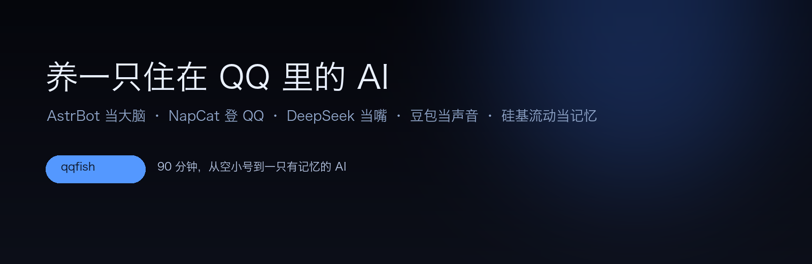

<div align="center">



**AstrBot 当大脑 · NapCat 登 QQ · DeepSeek 当嘴 · 豆包当声音 · 硅基流动当记忆**

从一个空 QQ 小号，到一只有记性、会发表情包、会主动找你说话的大肥鱼


</div>

---

## 💡 这个项目是怎么来的

我想养一只自己的 AI。

不是那种打开网页才能聊的，是**住在 QQ 里**的：我半夜睡不着打开手机，它就在那儿；我隔三天不说话，它会自己来找我。

于是我拿一个几乎不用的 QQ 小号，从零搭了一套：

- **AstrBot** 当大脑（对话、记忆、插件调度）
- **NapCat** 让这个号能被程序驱动（QQNT 注入）
- **DeepSeek** 当嘴（`deepseek-flash`，便宜、回得快）
- **豆包 Seed Audio** 当声音（她说话是语音，不是文字）
- **硅基流动 bge-m3** 当记忆（长期记忆的向量库）

调了三天，踩了一路坑：QQ 签名过不了、注入后白屏、掉线要重新扫码、表情包发黑、语音概率掷骰子、白名单写错全被拦……

这个仓库就是那三天，写成了一份**能照着复刻的说明书**。

现在她叫大肥鱼，一只有点馋、有点懒、有点傲娇的小鲸鱼。

---

## 这套东西和别的方案有什么不一样

| | 纯调 API 写个脚本 | NoneBot 从零写 | **这套（AstrBot + NapCat）** |
|---|---|---|---|
| 上手时间 | 几天 | 一两周 | **一两个小时** |
| 记忆 | 自己写 | 自己写 | 内置长期记忆（向量库） |
| 语音 | 自己接 | 自己接 | 插件，配好 key 就能说 |
| 表情包 | 没有 | 没有 | 表情包管理器 + 现成两套 |
| 主动找人 | 自己写定时 | 自己写 | 插件，能配「多久没说话就去找」 |
| 人格 | 一个 prompt | 一个 prompt | 人格系统 + 分段回复 + 插件联动 |

**它替你做掉的，是那些最耗时间、又跟「像不像个人」关系最大的部分**：记忆、语音、表情、主动。

---

## 一句话安装

> 把这句话发给你的 AI 助手（Claude Code / Cursor / DeepSeek 都行）：
>
> 「克隆 https://github.com/Yiyu5331/dafeiyu-qq-bot ，照着 docs/01 到 docs/10 一步一步装，装完按 docs/09 自检，遇到要扫码的地方停下来叫我。」

它会替你读文档、装依赖、改配置；只有**扫码登录**和**点系统确认框**这两件事必须你自己来。

---

## 装完是什么样

```
你的手机 QQ  ──私聊──►  QQ 服务器  ──►  NapCat（注入在 QQNT 里）
                                          │  反向 WebSocket
                                          ▼
                                     AstrBot（127.0.0.1:6199）
                                          │
                        ┌─────────────────┼─────────────────┐
                        ▼                 ▼                 ▼
                  DeepSeek 对话      长期记忆(向量)      豆包语音 / 表情包
```

她能做到：

- 记得你三天前说过的话（长期记忆，向量召回）
- 说话是**语音**，不是一段文字（豆包 Seed Audio 整段合成）
- 会发表情包（两套，161 个，按情绪分类）
- 一段时间没说话，会**主动来找你**
- 会自己改签名、发 QQ 空间、唱歌（可选插件）
- 只认你一个人的私聊，别人加她也不理（白名单）

---

## 一次完整的流程（大约 90 分钟）

| 步骤 | 做什么 | 时间 | 需要你手动吗 |
|---|---|---|---|
| 0 | **装 DSH（DeepSeek Harness）** | 10 min | 下载 / 点确认 |
| 1 | 装环境（Python / uv / Node / ffmpeg） | 15 min | 否 |
| 2 | 克隆 QQ App，注入 NapCat，扫码登录小号 | 30 min | **要扫码** |
| 3 | 装 AstrBot，起后台 | 10 min | 否 |
| 4 | 两边连起来（反向 WS + token） | 5 min | 否 |
| 5 | 配三把 key（DeepSeek / 豆包 / 硅基流动） | 10 min | 申请 key 要你 |
| 6 | 写人格（可以直接用 `configs/persona.example.md`） | 10 min | 否 |
| 7 | 安全护栏（白名单 + 管理员 + 关电脑操作） | 5 min | 否 |
| 8 | 表情包 / 语音 / 记忆插件 | 10 min | 否 |
| 9 | 自检 + 第一次对话 | 5 min | 否 |

---

## 目录

| 文档 | 内容 |
|---|---|
| [docs/00-装DSH.md](docs/00-装DSH.md) | **从装 DeepSeek Harness 开始**：下载、安装、工作区、权限 |
| [docs/01-环境与目录.md](docs/01-环境与目录.md) | 装什么、装在哪、macOS 和 Windows 的差别 |
| [docs/02-装NapCat并注入QQ.md](docs/02-装NapCat并注入QQ.md) | **最坑的一步**：为什么必须克隆 App、怎么过签名、怎么扫码 |
| [docs/03-装AstrBot.md](docs/03-装AstrBot.md) | 源码安装、后台、改密码 |
| [docs/04-把两边连起来.md](docs/04-把两边连起来.md) | 反向 WebSocket、token、连不上怎么查 |
| [docs/05-接模型.md](docs/05-接模型.md) | DeepSeek、豆包语音、硅基流动记忆，三把 key |
| [docs/06-给它人格.md](docs/06-给它人格.md) | 人格怎么写才像人、分段回复、主动找人 |
| [docs/07-表情包.md](docs/07-表情包.md) | 表情包管理器、分类、为什么不能放大 |
| [docs/08-安全护栏.md](docs/08-安全护栏.md) | 只让你的号能聊、关掉电脑操作、密码管理 |
| [docs/09-运维与排障.md](docs/09-运维与排障.md) | 12 个真实踩过的坑、日志在哪、怎么恢复 |
| [docs/10-一天怎么用.md](docs/10-一天怎么用.md) | 装完之后每天怎么养它 |
| [docs/11-逐条命令清单.md](docs/11-逐条命令清单.md) | **照抄版**：每条命令 + 成功长什么样 + 报错怎么办 |
| [skill/SKILL.md](skill/SKILL.md) | 给 AI 助手读的安装 skill |

---

## 成本

| 项目 | 费用 |
|---|---|
| AstrBot | 免费，跑在自己电脑上 |
| NapCat | 免费 |
| DeepSeek（deepseek-flash） | 一天闲聊几十轮 ≈ 几分钱 |
| 豆包 Seed Audio | 一条语音 ≈ 0.03 元，一天 10 条 ≈ 0.3 元 |
| 硅基流动 bge-m3 | 长期记忆 embedding，一天几分钱 |
| **合计** | **一天 5 毛以内** |

---

## ⚠️ 用之前必须知道的

1. **这是给一个「自己的号」用的**。用主号做实验有被封风险，用小号。
2. **NapCat 是第三方注入**，腾讯随时可能改协议。掉线很正常，文档里有免扫码重登的办法。
3. **别让它进群乱说话**。默认配置是只回你的私聊，保持这样。
4. **key 和密码不要写进仓库**。这个仓库所有示例都是占位符。

---

<div align="center">

MIT License · 给想养一只自己 AI 的人

</div>
